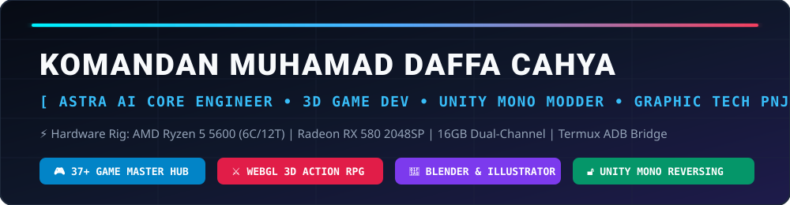

<div align="center">
  
</div>

<br/>

<div align="center">

[](https://zordanjimbak0-art.github.io/daffa-master-astra/)
[](https://zordanjimbak0-art.github.io/daffa-master-astra/portal.html)
[](https://zordanjimbak0-art.github.io/daffa-master-astra/spacex_falcon9_simulator.html)
[](https://github.com/zordanjimbak0-art/daffa-master-astra/releases)

</div>

---

### 👨‍🚀 Tentang Saya — **Komandan Muhamad Daffa Cahya**

- 🎓 **Akademik:** Mahasiswa **Teknik Grafika & Penerbitan (TCG)** — **Politeknik Negeri Jakarta (PNJ)**
- 🏭 **Industri & Praktik:** Kemasan & Produksi Grafika — **CV Cetak Cup / CV Saka Agung (Depok)**
- 🤖 **Ekosistem Sistem:** Pengembang **ASTRA AI Command Center v6.0 Ultra** (37+ Game Library, Auto-Trainer, VRAM Governor, & ADB Companion)
- 🛠️ **Spesialisasi Teknis:**
  - **Game Development & 3D Web:** Three.js WebGL First-Person RPG, Godot Engine 4 (GDScript 2.0), PBR Materials & GLTF Animation Pipeline
  - **Game Modding & Reverse Engineering:** Unity Mono `.dll` Assembly Inspection, Runtime Memory Pointer Hooking, XOR Save Decryption, AutoHotkey & Python Overlay Trainers
  - **3D Packaging & Prepress:** Blender 3D (`bpy` Cycles Photorealistic Rendering) & Adobe Illustrator ExtendScript Structural Dieline Automation

---

### 🚀 Proyek Unggulan & Live Demo

| Proyek | Kategori | Link Live / Repo | Status |
| :--- | :--- | :--- | :--- |
| **🎮 Daffa Master Command Center v6.0 Ultra** | Desktop Hub (CustomTkinter + Steam HD API) | [Lihat Kode](https://github.com/zordanjimbak0-art/daffa-master-astra/tree/main/1_Daffa_Master_Command_Center) | ✅ **v6.0 Active** |
| **⚔️ Astra 3D Action RPG (First-Person Edition)** | Three.js WebGL + GitHub PBR & `.glb` Assets | [**👉 MAIN SEKARANG**](https://zordanjimbak0-art.github.io/daffa-master-astra/) | 🌐 **Online 24/7** |
| **🚀 SpaceX Falcon 9 3D Orbital Simulator** | Interactive 3D Physics & Telemetry | [**👉 BUKA SIMULATOR**](https://zordanjimbak0-art.github.io/daffa-master-astra/spacex_falcon9_simulator.html) | 🌐 **Online 24/7** |
| **🏎️ HexGL 3D Futuristic Cyber Racing** | Three.js WebGL Anti-Gravity Racing (Forked & Hosted) | [**👉 MAIN BALAP 3D**](https://zordanjimbak0-art.github.io/daffa-master-astra/games/hexgl/index.html) | 🌐 **Online 24/7** |
| **🔮 Astray 3D Dungeon Maze Ball** | Three.js + Box2D 3D Physics Labirin | [**👉 MAIN LABIRIN 3D**](https://zordanjimbak0-art.github.io/daffa-master-astra/games/astray/index.html) | 🌐 **Online 24/7** |
| **🔷 Hextris Cyber Arcade** | HTML5 High-Speed Hexagon Arcade | [**👉 MAIN HEXTRIS**](https://zordanjimbak0-art.github.io/daffa-master-astra/games/hextris/index.html) | 🌐 **Online 24/7** |
| **🔓 Astra Unity Mono Mod Menus (My Voice Zoo)** | Memory Hooking & Save XOR Unlocker | [Lihat Kode](https://github.com/zordanjimbak0-art/daffa-master-astra/tree/main/4_Astra_Unity_Mono_Mod_Menus) | ✅ **Verified** |
| **📦 Blender 3D Packaging & Dieline Pipeline** | Photorealistic Cycles Render + `.jsx` Prepress | [Lihat Kode](https://github.com/zordanjimbak0-art/daffa-master-astra/tree/main/5_Blender_3D_Packaging_Pipeline) | ✅ **Production** |
| **🛒 Online Shop Depok + 3D Cup Studio** | E-Commerce & Three.js 3D Packaging Configurator | [**👉 BUKA 3D STUDIO**](https://zordanjimbak0-art.github.io/onlineshop-depok/viewer3d.html) | 🌐 **Online 24/7** |
| **🤖 Bot Daffa Privat (`bot-daffa-privat`)** | Automation & Private Bot System | [Buka Repo](https://github.com/zordanjimbak0-art/bot-daffa-privat) | 🔒 **Active** |

---

### 💻 Spesifikasi Stasiun Kerja (ASTRA RIG)

```yaml
Processor   : AMD Ryzen 5 5600 (6 Cores / 12 Threads @ 4.4GHz Boost)
Graphics    : AMD Radeon RX 580 2048SP (4GB GDDR5 — Tuned via Astra VRAM Governor)
Memory      : 16GB Dual-Channel DDR4
Mobile Link : Samsung Galaxy A16 via ADB Bridge (Termux Ubuntu Linux)
Controller  : 60% Mechanical Layout (Ergonomic Layer Remapped)
```
